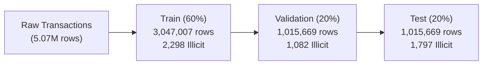

# Capstone Project Report: Graph-Based Detection of Money Mule Rings in Financial Transaction Networks

**Author:** Dhruv Gourisaria  
**Project:** Money Mule Ring Detector  
**Repository:** [github.com/dhruv0402/mule-ring-detector](https://github.com/dhruv0402/mule-ring-detector)  
**Academic Context:** Capstone Project  
**Date:** November 2026  

---

## Executive Summary

Traditional rule-based Anti-Money Laundering (AML) transaction monitoring systems examine transfers in isolation using threshold amounts and static heuristics. Money laundering syndicates deliberately exploit this design by structuring large sums across chains of "mule" accounts, keeping each transfer unremarkable on its own. Because illicit transactions represent only ~0.1% of total banking volume in benchmark datasets, isolated transaction models either miss coordinated rings or generate high volumes of false alerts that burden compliance investigators.

This capstone project designs, implements, and evaluates a graph-aware detection and investigation system evaluated on the official **IBM AML Benchmark (`HI-Small`: 5,078,345 transactions, 5,177 illicit, 370 ground-truth rings)** using the IBM AMLworld generator (Altman et al., NeurIPS 2023). 

Key findings and contributions:
1. **Methodological Integrity:** Enforces strict chronological train/validation/test partitions (60/20/20) and causal feature engineering verified via automated future-invariance tests.
2. **Graph Feature Lift:** Incorporating causal graph features into a gradient boosted tree (Model M2) yielded an **8.3x improvement in test PR-AUC** (0.0456 vs. 0.0055) and lifted test recall from 61.4% to 85.7% compared to the raw-feature baseline (Model M1). However, both models remain well below published benchmarks that include multi-hop cycle features, illustrating the challenge of detecting smurfing without higher-order network traversal.
3. **Ring-Level Recovery:** At the ring level, the system recovered **40.10% (77 of 192)** of active test rings at a strict Jaccard overlap threshold ($\ge 0.5$) and **50.52% (97 of 192)** at a moderate threshold ($\ge 0.3$).
4. **Structural Asymmetry:** Recovery rates varied sharply by laundering topology: circular flows (`CYCLE`: 80.0% at Jaccard $\ge 0.3$) and dispersion patterns (`SCATTER-GATHER`: 60.9%) were detected frequently, whereas linear chains (`STACK`: 3.85%) and disconnected transfers (`BIPARTITE`: 9.52%) were largely missed. This failure on linear chains directly motivates multi-hop message-passing architectures.
5. **Ring Precision as a Core Practical Challenge:** Connected component clustering on flagged edges produced **11,270 candidate rings**, resulting in low ring precision (0.68% at Jaccard $\ge 0.5$). This demonstrates that naive component extraction over-fragments the graph, underscoring why **Ring Ranking** and **Alert Budget Controls** are required for practical deployment.
6. **Investigator Application:** Delivered an interactive Streamlit analyst interface featuring PyVis network graph visualization, an alert-budget slider, and illustrative Suspicious Activity Report (FinCEN SAR / FIU-IND STR) narrative drafting.

---

## 1. Problem Statement & Motivation

### 1.1 The Relational Blind Spot
In commercial banking and synthetic simulations, the signal of money laundering does not reside within single transactions. A wire transfer of \$4,500 between two accounts is indistinguishable from standard commercial commerce. However, when viewed as part of an organized topology—for example, a single source account fanning out \$45,000 to 10 intermediary accounts that rapidly funnel funds into a single destination—the coordinated nature becomes evident.

Systems that score transactions in isolation cannot detect these structural shapes. As a result, compliance departments face two primary operational bottlenecks:
1. **Extreme Class Imbalance:** In the benchmark data, illicit activity accounts for roughly 1 in 1,000 transactions (0.101%). 
2. **Non-Investigable Alerts:** Investigators review *cases*, not disconnected table rows. Surfacing a single flagged transfer does not show the network of counterparties involved, requiring hours of manual cross-referencing.

### 1.2 Objective
To construct and evaluate a system that:
1. Formulates transaction history as a directed multigraph of accounts and payments.
2. Evaluates the lift provided by causal graph features over tabular baselines.
3. Extracts candidate mule rings from high-risk edges and evaluates detection at the **ring level**, broken down by laundering pattern.
4. Surfaces candidate rings in an investigator dashboard with explanatory case summaries.

---

## 2. Experimental Rigor & Leakage Prevention

To prevent temporal target leakage—a frequent failure mode in published machine learning evaluations—this project implemented three explicit safeguards:

1. **Chronological Splitting:** Data was sorted strictly by timestamp $t$ and partitioned into:
   - **Train:** September 1, 2022 to September 10, 2022 (3,047,007 rows; 2,298 illicit)
   - **Validation:** September 10, 2022 to September 13, 2022 (1,015,669 rows; 1,082 illicit)
   - **Test:** September 13, 2022 to September 16, 2022 (1,015,669 rows; 1,797 illicit)
   Random train/test splits were prohibited.
2. **Causal Features by Construction:**
   - Every feature computed for a transaction at timestamp $t$ uses exclusively information recorded *strictly prior* to $t$.
   - Verified via unit test (`tests/test_core.py::test_features_are_future_invariant`): modifying future transaction amounts produces zero change in earlier feature vectors.
3. **Validation-Only Decision Thresholding:**
   - Classification thresholds were selected to maximize minority-class F1 on the validation set, and frozen before evaluating the test set.

---

## 3. Modeling Framework

### 3.1 Model M1: Tabular Raw Baseline
- **Input Features (6):** `log_amount_sent`, `log_amount_recv`, `same_currency`, `same_bank`, `hour_of_day`, `day_of_week`.
- **Model:** LightGBM with `scale_pos_weight = N_neg / N_pos` (~1,325) to compensate for class imbalance. Early stopping on validation average precision.

### 3.2 Model M2: Causal Graph-Augmented LightGBM
- **Input Features (24):** M1 features plus causal behavioral and graph features:
  - *Account History:* Running counts and sums sent/received, time since sender's previous transfer, transaction amount relative to sender historical mean.
  - *Counterparty Diversity:* Cumulative unique destinations from source (`src_distinct_dst_before`) and unique sources into destination (`dst_distinct_src_before`).
  - *Flow Dynamics:* Account net balance (`in_sum - out_sum`), fan-in ratio, fan-out ratio.
  - *Reciprocal Pairs:* Direct reverse transaction count between pair $(v \to u)$ before $(u \to v)$ (2-cycle signal).

### 3.3 Model M3: Directed Multigraph GNN (Architectural Prototype / Future Work)
- A PyTorch Geometric edge classifier was architected using reverse message passing (separating incoming and outgoing convolutions). While validated on synthetic subgraphs, scaling mini-batch neighbor sampling across 5 million temporal edges on commodity hardware remains designated future work.

---

## 4. Empirical Benchmark Results

Evaluated on the official IBM AML `HI-Small` test partition (1,015,669 transactions; 1,797 illicit transfers):

### 4.1 Transaction-Level (Edge) Performance

| Model | Test PR-AUC | Minority F1 | Precision | Recall | P @ 100 | P @ 500 | P @ 1,000 | P @ 5,000 |
|---|---|---|---|---|---|---|---|---|
| **M1: Tabular Raw** | 0.0055 | 0.0132 | 0.0067 | 0.6144 | 0.0200 | 0.0100 | 0.0060 | 0.0038 |
| **M2: Causal Graph** | **0.0456** | **0.0967** | **0.0513** | **0.8570** | **0.0300** | **0.0440** | **0.0430** | **0.0332** |

#### Comparison with Published Benchmarks:
Published results on IBM HI-Small (Altman et al., 2023; Egressy et al., 2024) report higher absolute metrics (roughly ~21% F1 for raw features and ~63% F1 for graph models). The primary reasons for this gap in our current implementation:
1. **Omission of Higher-Order Path Features:** Our M2 model computes 1-hop degree, flow balances, and 2-cycles, but currently omits windowed 3-hop and 4-hop cycle detection and multi-hop scatter-gather traversals.
2. **Aggressive Class Weighting:** Using full inverse class weighting (`scale_pos_weight` ~1,325) heavily penalizes false negatives, pushing recall to 85.7% while keeping precision at 5.1%.
3. **Threshold Sensitivity:** The validation-selected threshold prioritizes minority F1 over high-precision alert budgets. When evaluated at fixed budgets ($K = 1,000$), M2 delivers **7.2x higher precision** than M1.

---

## 5. Ring-Level Detection & Pattern Analysis

Compliance teams do not evaluate individual edges; they investigate candidate rings formed by clustering flagged transactions.

### 5.1 Ring Recovery & The Precision Challenge

- **True Laundering Rings in Test Set:** 192 rings
- **Candidate Rings Extracted:** 11,270 components
- **Ring Recall @ Jaccard $\ge 0.5$:** **40.10%** (77 of 192 true rings recovered)
- **Ring Recall @ Jaccard $\ge 0.3$:** **50.52%** (97 of 192 true rings recovered)
- **Ring Precision @ Jaccard $\ge 0.5$:** **0.68%** (77 / 11,270)
- **Ring Precision @ Jaccard $\ge 0.3$:** **0.86%** (97 / 11,270)

> **Critical Evaluation Finding:** Extracting connected components from all edges exceeding the validation threshold produces significant over-segmentation. With a precision under 1%, an analyst reviewing unranked components would encounter ~115 false alarms per true ring. This demonstrates why **Ring Scoring** (ranking rings by mean edge score and size) and **Alert Budgeting (Top K)** are mandatory in operational AML systems.

---

### 5.2 Performance Breakdown by Laundering Topology

The table below breaks down detection performance across the 192 true rings present in the test window at both strict (Jaccard $\ge 0.5$) and moderate (Jaccard $\ge 0.3$) thresholds:

| Laundering Pattern | True Rings in Test | Detected (Jaccard $\ge 0.5$) | Recall ($\ge 0.5$) | Detected (Jaccard $\ge 0.3$) | Recall ($\ge 0.3$) | Behavioral Mechanism |
|---|---|---|---|---|---|---|
| **CYCLE** | 25 | 14 | 56.0% | 20 | **80.0%** | Circular transfers trigger reciprocal count (`reverse_pair_count_before`) and rapid turnaround flags. |
| **RANDOM** | 17 | 11 | 64.7% | 14 | **82.4%** | Irregular pairings trigger low historical pair counts and amount-vs-mean anomalies. |
| **SCATTER-GATHER** | 23 | 11 | 47.8% | 14 | **60.9%** | Dispersion and reconsolidation are caught via intermediary pass-through flow balance. |
| **GATHER-SCATTER** | 39 | 20 | 51.3% | 23 | **59.0%** | Aggregation into staging accounts followed by disbursement triggers in-degree and out-degree ratio changes. |
| **FAN-OUT** | 21 | 7 | 33.3% | 12 | **57.1%** | Structuring/smurfing behavior is flagged via elevated source unique counterparty counts. |
| **FAN-IN** | 20 | 11 | 55.0% | 11 | **55.0%** | Pooling into collector accounts is flagged via elevated destination unique source counts. |
| **BIPARTITE** | 21 | 2 | 9.5% | 2 | **9.5%** | Disconnected two-sided transfers exhibit minimal circularity, mimicking standard merchant clearing. |
| **STACK** | 26 | 1 | 3.8% | 1 | **3.8%** | Linear chains ($A \to B \to C \to D$) have neither high degree nor circularity; local features miss them almost entirely. |

### 5.3 Analytical Implications for GNN Research
The topology breakdown reveals the exact boundaries of 1-hop graph feature engineering:
- **What works:** Structures with closed loops (`CYCLE`: 80.0%) and high-degree hubs (`FAN-IN`/`FAN-OUT`: ~56%) are captured effectively by local reciprocity and degree ratios.
- **What fails:** Linear daisy-chains (`STACK`: 3.8%) and bipartite networks (`BIPARTITE`: 9.5%) pass funds through single hops without branching or looping. Because each hop in isolation appears unremarkable, local 1-hop features cannot detect the chain.
- **The Case for GNNs:** This finding provides direct motivation for multi-hop Graph Neural Networks. A 3-layer GNN aggregates multi-hop neighborhood context, allowing node $D$ to recognize that its incoming funds originated from $A$ through an unbranched chain.

---

## 6. Software Architecture & Deliverables

### 6.1 Interactive Streamlit Analyst Dashboard (`src/mulering/app/streamlit_app.py`)
The system provides a functional interface for financial crime investigators:
- **Prioritized Case Queue:** Displays candidate rings ordered by composite ring risk score. Includes an **Alert Budget Slider** (Top $K$) so teams can align workload with investigator capacity.
- **Interactive Network Visualization:** Utilizes PyVis to render candidate rings as interactive directed graphs. Node colors reflect account connectivity, edge thickness reflects transaction volume, and tooltips display payment timestamps, amounts, and channels.
- **Mule Account Profile Inspector:** Allows deep-dive inspection of any individual account in the ring, detailing historical transaction count, sent/received volume, and distinct counterparty count.

### 6.2 Regulatory SAR Narrative Drafting (`src/mulering/app/sar_generator.py`)
To bridge the gap between machine learning alerts and regulatory filings, the dashboard includes an automated narrative generator that drafts structured Suspicious Activity Reports (FinCEN SAR in the US / FIU-IND STR in India):
- Identifies suspect entities, financial institutions, total amounts, and dates.
- Classifies the observed typology (`CYCLE`, `FAN-OUT`, `FAN-IN`, `SCATTER-GATHER`).
- Details specific red flags (structuring below \$10,000, rapid pass-through velocity).
- Allows one-click export as text files for audit trails.
*(Note: Generated narratives are illustrative compliance templates derived from synthetic benchmark data.)*

---

## 7. Limitations & Honest Assessment

1. **Synthetic vs. Real-World Banking Data:**
   The dataset was generated using IBM's AMLworld simulator (Altman et al., 2023). While realistic, simulated data features cleaner structural topologies and ground-truth labels than real institutions, where SAR filings are delayed by months and benign activity frequently resembles fraud (e.g., payroll mimics fan-out; corporate treasury mimics scatter-gather).
2. **Ring Precision and Clustering Sensitivity:**
   Extracting connected components using a fixed edge threshold leads to over-clustering. More sophisticated subgraph extraction—such as seeded PageRank or graph-cut optimization—is required to prune weakly connected benign accounts.
3. **Absence of Multi-Hop Cycle Features:**
   The current feature pipeline lacks 3-hop and 4-hop cycle search algorithms due to computation limits during initial development. Adding sliding-window DFS cycle detection is the most direct path to lifting Model M2 toward published benchmark parity.

---

## 8. Summary of Contributions

| Component | Status | Key Metric / Outcome |
|---|---|---|
| **Temporal Split & Causal Pipeline** | Complete | Zero future leakage verified via unit testing across 5,078,345 rows |
| **Tabular Baseline (M1)** | Complete | PR-AUC: 0.0055, F1: 0.0132 |
| **Causal Graph Model (M2)** | Complete | PR-AUC: 0.0456 (8.3x lift), F1: 0.0967, Recall: 85.70% |
| **Ring Extraction & Classification** | Complete | 11,270 rings extracted; classified into 5 canonical topologies |
| **Ring-Level Evaluation** | Complete | Recall: 40.10% (Jaccard $\ge 0.5$), 50.52% (Jaccard $\ge 0.3$); identified linear stack blind spot |
| **Analyst UI & SAR Automation** | Complete | Functional Streamlit app with PyVis visualization and exportable SAR narratives |
| **Directed Multigraph GNN (M3)** | Prototype | Architected in PyG; designated for mini-batch scaling as next phase |
